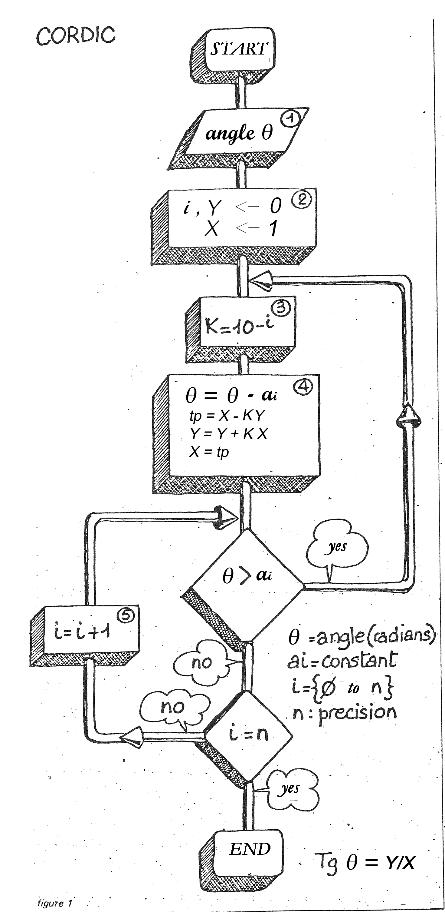

:::{.center}
{width=50%}
:::

### Résumé

Cet article décrit un algorithme pour le calcul de certaines fonctions élémentaires telles que le sinus, le cosinus, la tangente et l’arctangente. Cet algorithme est celui utilisé par les calculatrices. Le principe de cet algorithme est l’utilisation de rotations dans un système de coordonnées circulaires. Les seules opérations nécessaires à l’exécution de l’algorithme sont l’addition, la soustraction, la recherche dans une table et le déplacement d’une virgule dans la représentation d’un nombre en virgule flottante.

[<i class="bi bi-file-pdf"></i> PDF](/articles/2015-algorithme-cordic-amq.pdf){.btn .btn-primary target="_blank"}
