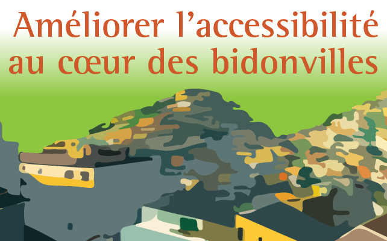

:::{.center}
{width=50%}
:::

### Résumé

Le Programme des Nations unies pour les établissements humains décrit un bidonville comme la partie défavorisée d’une ville caractérisée par des logements très insalubres et construits par les habitants avec des matériaux de récupérations, une grande pauvreté et sans aucun droit ou sécurité foncière. La plupart des habitants des bidonvilles n’ont pas accès à l’eau potable, ni aux égouts. Plusieurs résidences de bidonvilles n’ont pas d’adresse et ne peuvent pas être facilement rejointes par un véhicule, ce qui rend difficile l’accès aux services médicaux et aux services d’incendie.

[<i class="bi bi-file-pdf"></i> PDF](/articles/2023_bidonvilles.pdf){.btn .btn-primary target="_blank"}

[<i class="bi bi-easel"></i> Document source](https://accromath.uqam.ca/2023/10/ameliorer-laccessibilite-au-coeur-des-bidonvilles/){.btn .btn-primary target="_blank"}