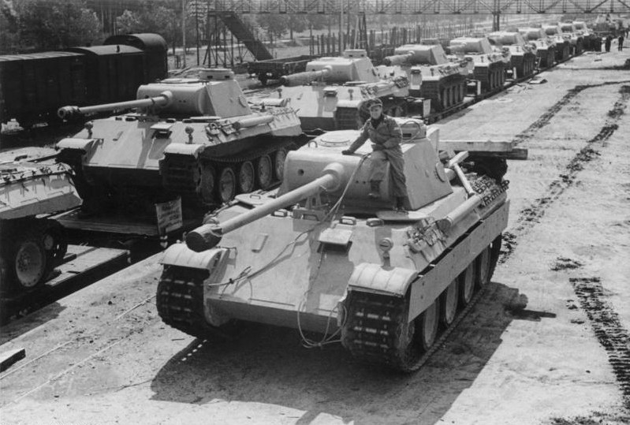

:::{.center}
{width=50%}
:::

### Résumé

Durant la Seconde Guerre mondiale, les Alliés avaient un besoin criant d’estimer avec précision la quantité de matériel militaire que l’Allemagne nazie produisait. Les estimations provenant des services de renseignements habituels étaient contradictoires et incertaines. Les gouvernements britanniques et américains se tournèrent donc vers des statisticiens pour savoir si leurs estimations pouvaient être améliorées. Nous présenterons une introduction aux notions mathématiques utilisées.

[<i class="bi bi-file-pdf"></i> PDF](/articles/2019-probleme-char-assaut-amq.pdf){.btn .btn-primary target="_blank"}
