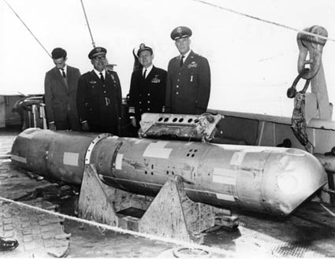

:::{.center}
{width=50%}
:::

### Résumé

Le 17 janvier 1966, suite à un accident en vol, l’armée américaine perd une bombe à hydrogène au large des côtes espagnoles, à proximité de Palomares. Le 22 mai 1968, le sous-marin nucléaire USS Scorpion est perdu en mer avec 99 marins à bord. Le 12 septembre 1857, le navire SS Central America sombre au fond de l’océan en emportant avec lui une cargaison de près de 11 tonnes d’or. Dans cet article, nous reviendrons brièvement sur l’historique de ces trois situations et sur les mathématiques qui ont permis aux personnes concernées de retrouver la bombe, le sous-marin et le trésor.

[<i class="bi bi-file-pdf"></i> PDF](/articles/2018-comment-chercher-amq.pdf){.btn .btn-primary target="_blank"}
