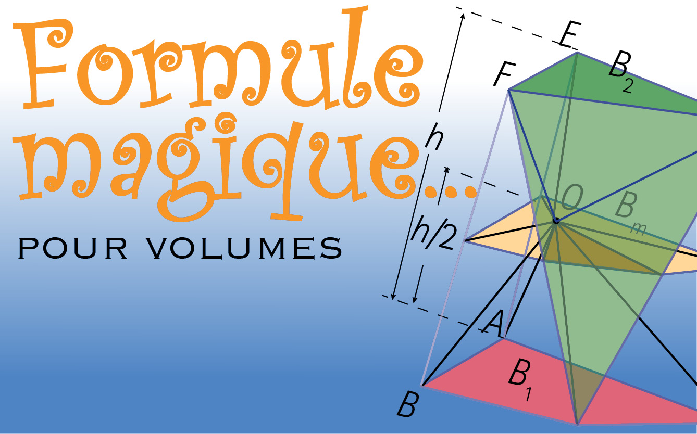

:::{.center}
{width=50%}
:::

### Résumé

Pour calculer le volume d’un prisme, d’une pyramide, d’un cylindre ou d’une sphère, on applique une formule adaptée à chacun des cas. Dans Formule magique… pour volumes, Marc-André Désautels montre que toutes ces formules font partie d’une même famille et peuvent toutes être déduites d’une même formule maîtresse.

[<i class="bi bi-file-pdf"></i> PDF](/articles/2020_formule_magique.pdf){.btn .btn-primary target="_blank"}

[<i class="bi bi-easel"></i> Document source](http://accromath.uqam.ca/2020/09/formule-magique-pour-volumes/){.btn .btn-primary target="_blank"}