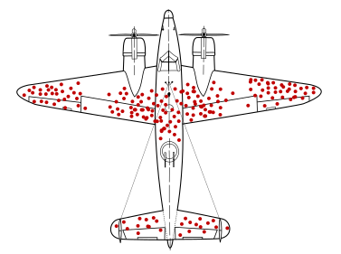

:::{.center}
{width=50%}
:::

### Résumé

Abraham Wald, surtout connu pour son invention de l’analyse séquentielle, a été un des membres du Statistical Research Group (SRG) qui a été créé de 1942 à 1945 pour aider dans l’effort de guerre. Nous discuterons du travail de Wald concernant le biais de l’armée américaine dans certaines de ses décisions et nous discuterons de la façon dont il s’y est pris pour estimer les probabilités qu’un avion de guerre criblé de balles revienne (ou pas!) du théâtre des opérations.

[<i class="bi bi-file-pdf"></i> PDF](/articles/2020_mais_ou_sont_trous_balle_amq.pdf){.btn .btn-primary target="_blank"}
