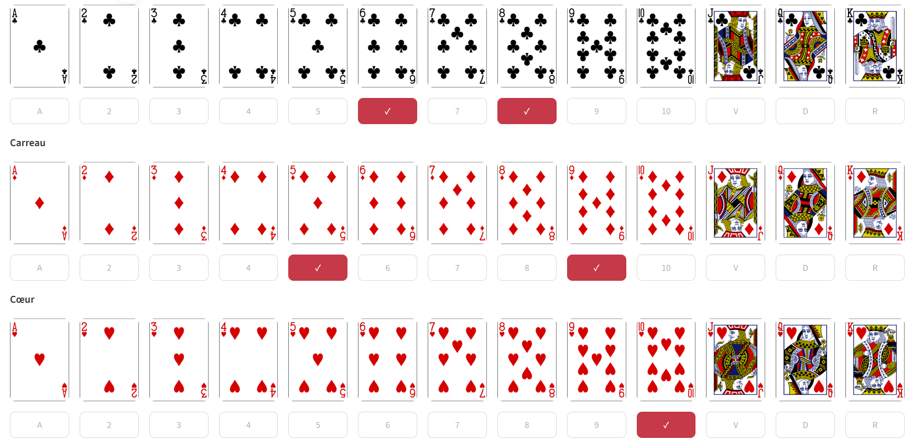
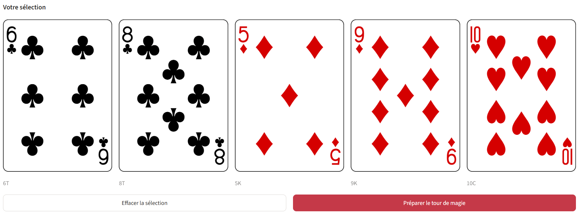
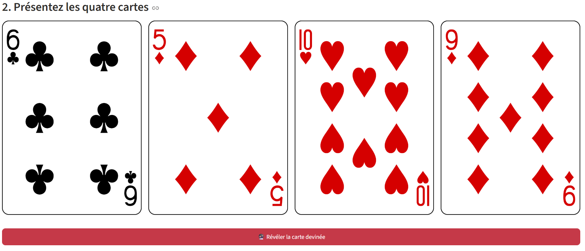
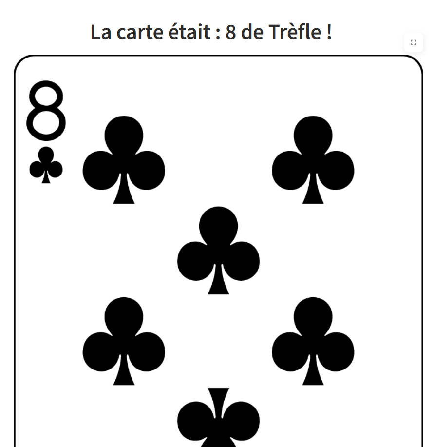

Suite à la présentation de Frédéric Gourdeau et de Catherine Bilodeau, intitulée *Magie et mathématique : un duo intrigant !*, j'ai eu envie de reproduire le tour de magie à 5 cartes qu'ils ont présenté.

Par contre, lorsque je présente le tour à mes étudiants, je n'ai pas de complice pour m'aider à faire le tour. J'ai donc décidé de créer un petit script en `Python` qui me permet de faire le tour de magie tout seul.

De plus, pour faciliter la présentation, j'ai décidé de créer un petit site web qui héberge mon code `Python`. J'ai utilisé [https://streamlit.io/](https://streamlit.io/) pour créer le site web. 

- Le code est disponible sur [GitHub](https://github.com/desautm/tour-magie-5-cartes)
- Le site web est disponible sur [https://tour-magie-5-cartes.streamlit.app/](https://tour-magie-5-cartes.streamlit.app/)

Pour effectuer le tour:

1. Vous demandez aux étudiants de choisir 5 cartes dans le jeu de 52 cartes. Vous ne devez pas les voir.

2. Vous demandez aux étudiants d'appuyer sur le bouton *Préparer le tour de magie*.

3. Vous réfléchissez quelques secondes en regardant les cartes affichées et vous trouvez la carte manquante! Vous pouvez appuyer sur le bouton *Révéler la carte devinée* pour vérifier votre réponse.

4. Vous pouvez recommencer le tour en appuyant sur le bouton *Recommencer le tour de magie*.

