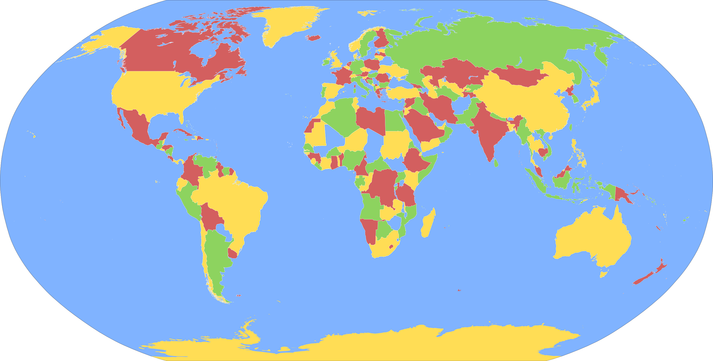

:::{.center}
{width=50%}
:::

> Je veux remercier Christian Côté pour l’idée de cet atelier.

Voici les documents utilisés dans la présentation sur le théorème des 4 couleurs

- La [présentation sous format PowerPoint](/fichiers/theoreme_4_couleurs.pptx).

- La [présentation sous format PDF](/fichiers/theoreme_4_couleurs_presentation.pdf).

- Le [livret sous format PDF](/fichiers/theoreme_4_couleurs_livret.pdf) utilisé pour discuter du théorème des 4 couleurs. Vous n’avez qu’à le plier en deux et vous dites aux élèves de colorier la coccinnelle avec **deux** couleurs, la fleur à 4 pétales avec **trois** couleurs et la dernière fleur avec **quatre** couleurs.

- Une [feuille sous format PDF](/fichiers/theoreme_4_couleurs_feuille.pdf) que les élèves peuvent ramener à la maison pour tenter de la colorier en n’utilisant que quatre couleurs.