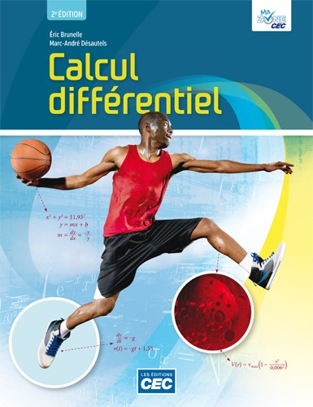

:::{.center}
{width=50%}
:::

### Résumé

La 2e édition de Calcul différentiel offre une présentation claire et simplifiée des notions propres au calcul différentiel, en mettant l’accent sur les exercices et la résolution de problèmes concrets et réalistes qui mettent en lumière les liens étroits entre le calcul différentiel et les applications utilisées dans la vie de tous les jours. En faisant appel à l’intuition, à une démarche rigoureuse, à la réflexion et à des techniques de résolution éprouvées, Calcul différentiel offre aux lecteurs un environnement d’apprentissage leur permettant de comprendre et de critiquer leurs propres résultats.

[<i class="bi bi-calculator"></i> Pour vous procurer le livre](https://editionscec.com/products/calcul-differentiel){.btn .btn-primary target="_blank"}

Cette nouvelle édition apporte nombre d’améliorations dont :

- Un contenu revu et corrigé pour le rendre plus clair et concis.
- Un premier chapitre optimisé autour des notions essentielles et de leurs applications qui fait un retour sur les contenus de base nécessaires à la compréhension des chapitres suivants.
- L’ajout d’une centaine d’exercices supplémentaires de mise en forme variés à la fin de chaque chapitre.
- L’identification du niveau de difficulté des exercices (facile, moyen et difficile).
- L’ajout d’une section sur les applications du calcul différentiel en administration.
- L’ajout d’un index des définitions, des théorèmes, des corollaires et des propositions.
- L’ajout d’activités de laboratoires pour accompagner l’apprentissage des notions (par exemple : le théorème des gendarmes; la continuité d’une fonction sur un intervalle).
- L’ajout d’exercices permettant d’introduire l’utilisation de logiciels libres, tel GeoGebra, pour faire du calcul différentiel.

La version numérique de Calcul différentiel est offerte gratuitement aux professeurs et étudiants sur MaZoneCEC, une zone multiplateformes accessible en ligne et hors ligne à partir d’un PC, d’un Mac ou des tablettes iPad et Android. Elle vous permet :

- de projeter et de feuilleter les pages de l’ouvrage en classe;
- d’annoter l’ouvrage au crayon et au marqueur;
- de sauvegarder vos notes personnelles;
- d’insérez vos propres liens Internet au fil des pages.

Elle vous donne aussi accès aux ressources complémentaires suivantes :

- Un test d’autoévaluation des connaissances en mathématique.
- Un solutionnaire détaillé (présenté par chapitre).
- Des exercices supplémentaires avec solutionnaire par chapitre.
- Des animations permettant de visualiser certains problèmes.
- Des problèmes à résoudre avec les logiciels Maple et Maxima.
- Des laboratoires sur l’utilisation de logiciels de calcul symbolique en calcul différentiel.
- Des laboratoires à effectuer à l’aide du logiciel Geogebra (manuel d’utilisation inclus).

L’accès 1 an à la version numérique uniquement est aussi disponible pour achat en ligne.