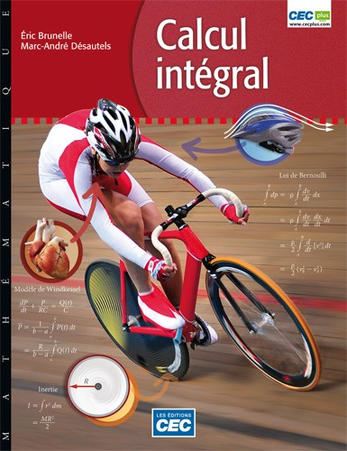

:::{.center}
{width=50%}
:::

### Résumé

Par sa démarche rigoureuse, Calcul intégral permet aux étudiants de faire l’apprentissage de techniques de résolution en les appliquant à des situations réelles. Cette application constante des notions théoriques sur des exemples concrets incite le développement d’une approche intuitive à la résolution de problème.

[<i class="bi bi-calculator"></i> Pour vous procurer le livre](https://editionscec.com/products/calcul-integral){.btn .btn-primary target="_blank"}

- Le premier chapitre effectue un retour sur les notions vues dans Calcul différentiel, il introduit aussi la règle de L’Hospital et la notion de différentielle
- Chaque chapitre suivant présente les notions clés à l’aide d’applications concrètes et de nombreux exemples
- Des techniques de calcul sont appliquées à la résolution d’équations différentielles tout au long du manuel
- Une nouvelle approche pour l’étude des séries qui met l’accent sur les séries de Taylor
- Fait de nombreux liens sur l’application de diverses notions mathématiques dans les sciences de la nature et les sciences humaines
- Des annexes pratiques sur les théorèmes d’analyse, l’application du calcul intégral en sciences humaines et l’utilisation de logiciels de calcul symbolique (comme Maxima ou Maple) pour la résolution de problèmes

En plus de vous permettre de gérer vos groupes d’étudiants, le complément pédagogique en ligne CEC Plus offre le solutionnaire des exercices et des annexes du manuel. Le CEC Plus est offert gratuitement sur adoption de la collection.

Sur adoption de la collection, la version numérique pour l’enseignant de Calcul Intégral vous est offerte gratuitement sur maZoneCEC, une zone multiplateformes accessible à partir d’un PC, d’un Mac ou des tablettes iPad et Android. Elle vous permet :

- de projeter et de feuilleter les pages de l’ouvrage en classe;
- d’annoter l’ouvrage au crayon et au marqueur;
- de sauvegarder vos notes personnelles;
- d’insérez vos propres liens Internet au fil des pages.